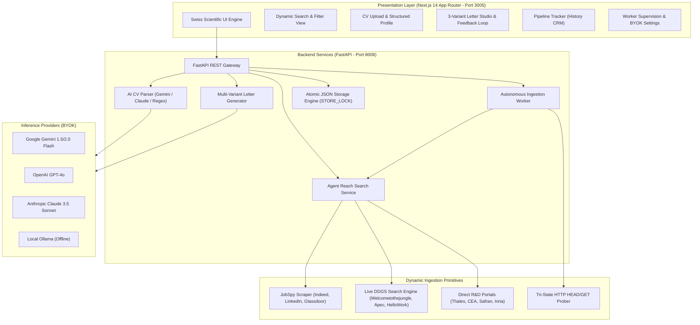
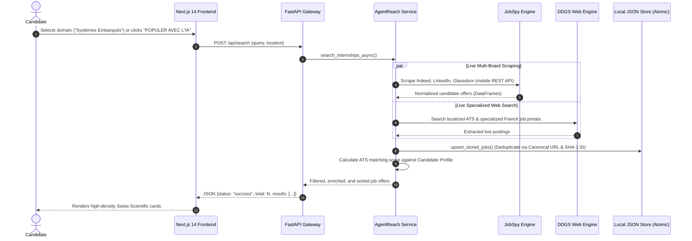
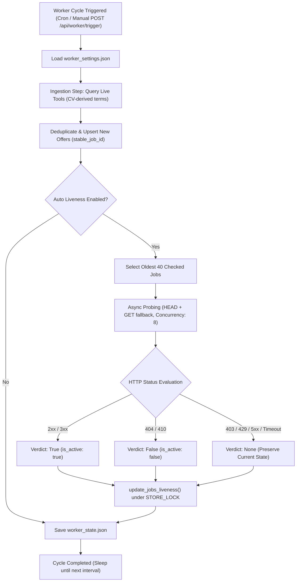

# InternReach System Architecture

> Architectural specifications, ingestion pipelines, liveness verification mechanisms, and design systems for the InternReach platform.

---

## 1. High-Level System Architecture

InternReach is structured as a decoupled client-server application engineered for maximum responsiveness, zero reliance on fragile fixed datasets, and privacy-preserving local storage.

---

## 2. Ingestion & Dynamic Search Flow

InternReach eliminates static registries in favor of live multi-source scraping with intelligent query partitioning and deduplication:

---

## 3. Autonomous Ingestion Worker & Liveness Loop

The background ingestion worker runs on a configurable cadence (default: every 6 hours) to discover new postings and verify the liveness of stored listings without false positives:

---

## 4. Security Architecture & Threat Defense

### 4.1 Multi-Hop SSRF Defense
External offer ingestion (`POST /api/search/import-offer`) poses a high Server-Side Request Forgery risk. The application enforces a multi-layer guard before making outbound HTTP requests:
1. **Scheme & Port Check:** Only `http` and `https` on ports `80` and `443` are accepted. Embedded credentials (`user:pass@host`) are rejected.
2. **DNS Multi-IP Verification:** Every IP returned by DNS is parsed into an `ipaddress` object. The request is aborted if any IP belongs to:
   - Loopback (`127.0.0.0/8`, `::1`)
   - RFC 1918 Private networks (`10.0.0.0/8`, `172.16.0.0/12`, `192.168.0.0/16`)
   - Link-local and cloud metadata (`169.254.0.0/16`, `fe80::/10`)
   - IPv4-mapped IPv6 notation (`::ffff:127.0.0.1`)
   - Internal top-level domains (`.local`, `.internal`, `.localhost`)
3. **Manual Redirect Inspection:** Automated redirect following is disabled. Up to 3 HTTP redirect hops are resolved and re-verified against the full SSRF validation routine before following.

### 4.2 API Key Transport & Masking
- **Header-Based Transport:** Google Gemini keys are sent via `x-goog-api-key` headers rather than URL query parameters, preventing key exposure in server access logs and proxy captures.
- **Egress Masking:** Server responses from `GET /api/settings` mask secret keys (`...xxxx`), storing full keys only in the local, git-ignored `settings.json` file.
- **CORS Restriction:** Local-only origins (`http://localhost:3005`, `http://127.0.0.1:3005`) with `allow_credentials=False`. Default binding restricted to `127.0.0.1`.

---

## 5. Storage Engine & Concurrency Control

All persistence in InternReach relies on local JSON documents within `backend/app/data/`:
- `profile.json`: Structured candidate profile, technical skills, target domains, and key projects.
- `jobs.json`: Deduplicated catalog of ingested job offers with metadata and liveness status.
- `history.json`: CRM pipeline records of applied and tracked positions.
- `settings.json`: BYOK API keys and model configurations.
- `worker_settings.json` & `worker_state.json`: Background worker schedules and sync telemetry.

### Concurrency & Atomic Writes
- **Process Lock:** All file updates are synchronized with a reentrant lock (`STORE_LOCK = threading.RLock()`).
- **Atomic File Swaps:** Files are written to a temporary sibling file via `tempfile.NamedTemporaryFile` and replaced atomically using `os.replace`, preventing partially written files during unexpected server terminations.
- **Test Isolation:** The `INTERN_REACH_DATA_DIR` environment variable allows automated test harnesses (`pytest`) to redirect all file I/O to a temporary scratch directory without touching production data.

---

## 6. Swiss Scientific Design System Specification

The user interface adheres to the **International Typographic Style** (Swiss Style), emphasizing clarity, structure, and functional minimalism:

| Element | Specification | Rationale |
|---|---|---|
| **Primary Typography** | `Inter`, sans-serif | High legibility for long-form scientific text and letter review. |
| **Monospace Typography** | `JetBrains Mono`, monospace | Technical metadata, ATS match scores, tags, and code badges. |
| **Primary Accent** | Cobalt Blue (`#0047AB`) | Rigorous, high-contrast, authoritative visual anchor. |
| **Neutral Background** | Clinical Light Grey (`#F8F9FA`) | Reduced eye fatigue during prolonged reading sessions. |
| **Card & Container Background** | Pure White (`#FFFFFF`) | Elevated surface contrast with minimal 1px borders (`#E2E8F0`). |
| **Emoji Policy** | Strictly Prohibited in UI Controls | Decorative emojis undermine scientific authority. Pure SVGs only. |

---

## 7. Architecture Decision Records (ADRs)

- [ADR-001: Dynamic Live Search Tools vs. Static Registries](adr/ADR-001-dynamic-live-search-vs-static-registries.md)
- [ADR-002: Autonomous Background Worker & Liveness Probing](adr/ADR-002-autonomous-liveness-verification-worker.md)
- [ADR-003: Hybrid AI and Regex Structured CV Extraction](adr/ADR-003-hybrid-ai-cv-parsing.md)
- [ADR-004: SSRF Defense, Concurrency Locking & Atomic File Storage](adr/ADR-004-ssrf-defense-and-storage-concurrency.md)
