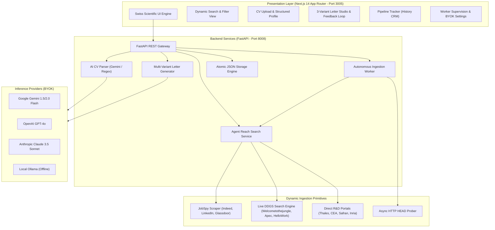
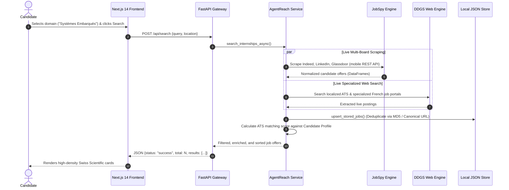
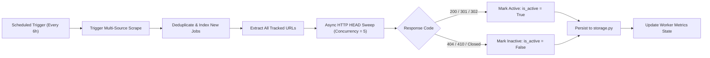
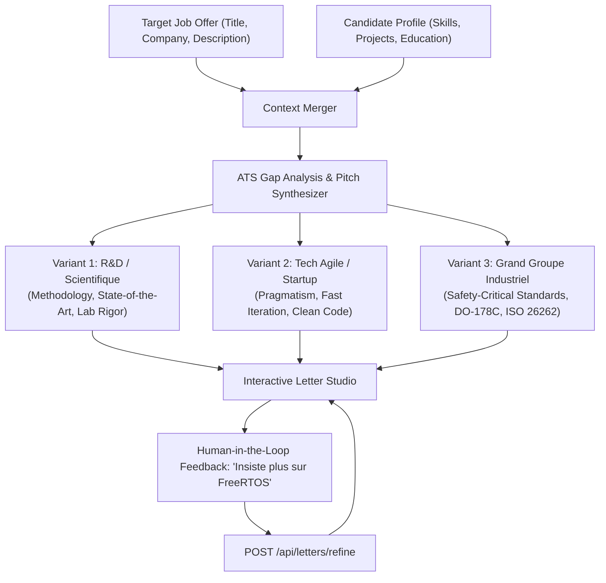

# InternReach System Architecture

> Architectural specifications, ingestion pipelines, liveness verification mechanisms, and design systems for the InternReach platform.

---

## 1. High-Level System Architecture

InternReach is structured as a decoupled client-server application engineered for maximum responsiveness, zero reliance on fragile fixed datasets, and privacy-preserving local storage.

---

## 2. Ingestion & Dynamic Search Flow

InternReach eliminates static registries in favor of live multi-source scraping with intelligent query partitioning and deduplication:

---

## 3. Autonomous Ingestion Worker & Liveness Loop

To prevent candidates from applying to expired job offers (HTTP 404 or closed career boards), the background worker performs asynchronous HEAD/GET probes and marks inactive postings.

---

## 4. Multi-Variant Motivation Letter Generation Pipeline

The letter generation engine analyzes the semantic gap between the candidate's CV and the recruiter's specifications, producing three distinct variants:

---

## 5. Security & BYOK Architecture

1. **Zero Cloud Credential Leakage:** API keys (`GEMINI_API_KEY`, `OPENAI_API_KEY`, `CLAUDE_API_KEY`) are stored locally in `backend/app/data/settings.json` and never transmitted to external telemetry or third parties.
2. **Masked Egress:** Endpoints returning settings (`GET /api/settings`) mask keys (`AIzaSy...4aB1`). Updating settings without re-entering the key preserves stored secrets safely.
3. **Local File Size Quotas:** CV uploads are capped strictly at 10 MB in memory with explicit `413 Payload Too Large` rejection to prevent resource exhaustion attacks.

---

## 6. Swiss Scientific Design System Specifications

The visual interface is built according to the **International Typographic Style (Swiss Style / Müller-Brockmann Grid)**:
- **Primary Color:** `#0047AB` (Cobalt Scientific Blue)
- **Background Color:** `#F8F9FA` (Clean Clinical Paper White)
- **Text Color:** `#121212` (Ultra-high contrast dark charcoal)
- **Borders & Dividers:** `1px solid #E5E7EB`
- **Typography:**
  - Headers & Technical Data: `JetBrains Mono`, `monospace`
  - Body & Long-form text: `Inter`, `sans-serif`
- **Visual Hygiene:** Strict avoidance of emojis in UI headers, buttons, and system badges; use of minimalist SVG wireframe icons and monochrome status pills.

